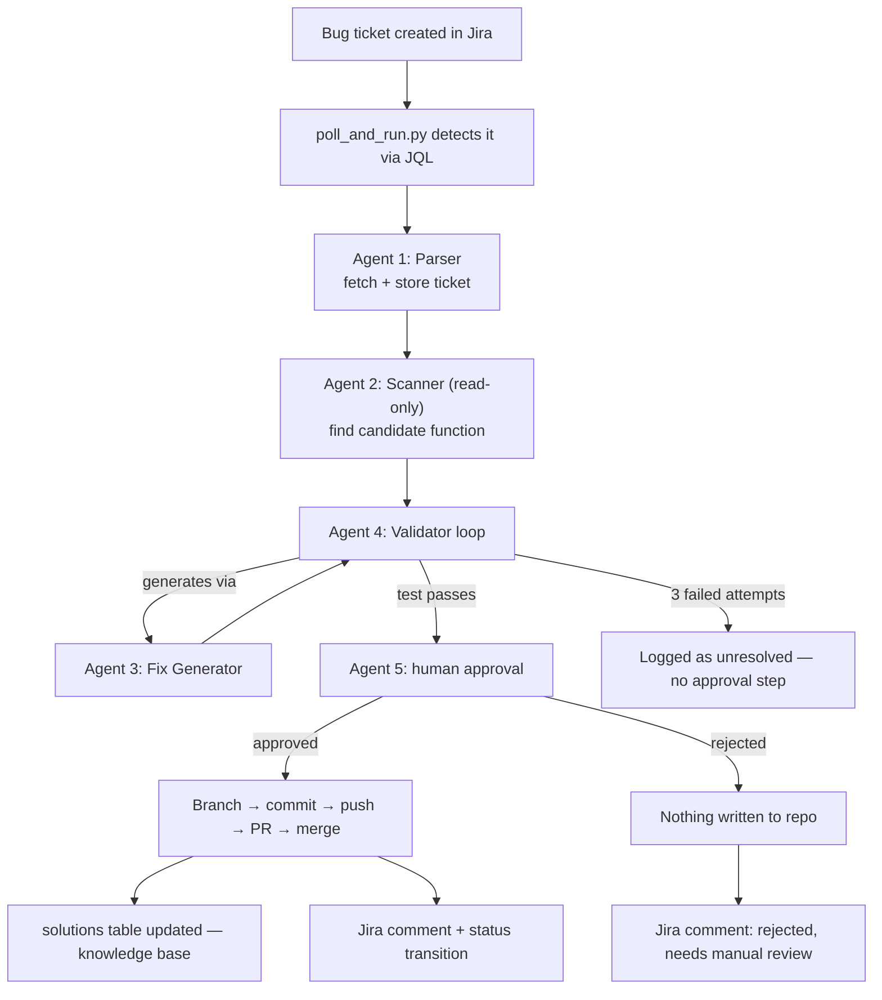

# Defect Resolution Agent — Project Documentation

A learning project that builds an end-to-end, multi-agent system which takes a Jira bug
ticket, finds the relevant code, generates a fix, validates it against a real test,
asks a human for approval, and (on approval) pushes a merged pull request to GitHub —
closing the loop by writing the resolution back onto the Jira ticket itself.

This document covers the architecture, how each agent works, what was actually built
and verified, the honest trade-offs of the current implementation, and how the same
system could evolve toward a production-grade, Azure-hosted deployment.

---

## 1. Project Goal

Understand, end-to-end, what it takes to build an "agentic" defect-resolution
workflow:

> Jira ticket → parse it → scan the codebase for the affected code → generate a
> fix → validate the fix against a real test → get human approval → merge to
> GitHub → write the resolution back to Jira → remember the fix for next time.

Every stage above was actually implemented and run against real tickets and a real
(if small) codebase — not simulated.

---

## 2. Two Separate Repositories

The project deliberately uses **two separate git repositories**, not one:

| Repo | Purpose |
|---|---|
| **MiniShop** | The *target* application — a small FastAPI app with 5 deliberately seeded bugs. This is the codebase the agent reads and patches. |
| **Defect-Agent-Pipeline** | The *automation* — the 5 agents, the database, and the Jira/GitHub integration code. This never gets patched by itself; it only acts on MiniShop. |

Keeping them separate mirrors how a real automation bot is set up in production: the
bot's own code lives somewhere independent of the codebase it operates on, so the
bot's commits/PRs never get mixed into its own repository's history, and its GitHub
token can be scoped to only the target repo.

---

## 3. Tech Stack

| Layer | Choice | Notes |
|---|---|---|
| Language | Python 3.12 / 3.13 | Both repos use plain Python, no compiled dependencies |
| Target app framework | FastAPI | MiniShop's web framework |
| LLM runtime | **Ollama** (local, self-hosted) | No cloud LLM API or billing involved |
| Code-generation model | `qwen2.5-coder:1.5b` | Chosen specifically for an 8 GB RAM laptop; `qwen2.5-coder:7b` is the better-quality option with more RAM |
| Embedding model | `mxbai-embed-large` | Used for codebase similarity search and the knowledge base |
| LLM integration library | `langchain-ollama` | Used only for its `ChatOllama` and `OllamaEmbeddings` wrapper classes — see note below |
| Issue tracker | Jira Cloud (free tier) | Accessed via the `jira` Python library and REST API tokens |
| Version control / PRs | GitHub | Accessed via `PyGithub` (GitHub REST API wrapper) |
| Storage | SQLite (single file, `defect_agent.db`) | No external database server |
| Testing | `pytest` | Both to test MiniShop itself and as Agent 4's validation mechanism |
| Environment/config | `python-dotenv` + `.env` | Credentials and paths, never committed |

### An honest note on "LangChain" and "LangGraph"

Early exploration for this project discussed using **LangGraph** (a state-graph
orchestration library) to wire the agents together, and a **GraphRAG**-style
knowledge graph for the solutions database. **The final implementation does
not actually use either of these.**

- **Orchestration** is plain, hand-written Python: each agent is a normal function;
  Agent 4's retry loop is a `for` loop; the human-approval gate is a blocking
  `input()` call; the polling script is a `while True` loop with `time.sleep()`.
  No `langgraph.graph.StateGraph`, no declared nodes/edges, no built-in
  checkpointing.
- **LangChain** is used *only* for its thin Ollama wrapper classes
  (`ChatOllama`, `OllamaEmbeddings`) — not its chains, agents, or tool-calling
  abstractions.
- The **knowledge base** (`solutions` table) is flat vector similarity — each
  resolved ticket's embedding is stored as a JSON blob in SQLite, and a new
  ticket is compared against all of them with brute-force cosine similarity in
  Python/NumPy. There is no real graph structure (no nodes/edges linking
  components, tickets, and fixes) and therefore no multi-hop graph traversal —
  i.e., no actual "GraphRAG" in the final system.

This is called out explicitly because it's an important, honest distinction: the
project **works**, but it works as a simple, linear, hand-orchestrated pipeline —
not as a formal multi-agent graph framework. Section 11 and Section 13 revisit this
as a concrete upgrade path.

---

## 4. Requirements / Prerequisites

To run this project from scratch, you need:

1. **Python 3.10+** installed, with `venv` available.
2. **Ollama** installed and running locally, with two models pulled:
   ```bash
   ollama pull qwen2.5-coder:1.5b   # or :7b with more RAM
   ollama pull mxbai-embed-large
   ```
3. **A Jira Cloud account** (free tier is enough), with:
   - A project created (gives you a project key, e.g. `SCRUM`)
   - An API token generated at
     `https://id.atlassian.com/manage-profile/security/api-tokens`
4. **A GitHub account**, with:
   - The MiniShop repo created and pushed
   - A fine-grained Personal Access Token scoped to *only* the MiniShop repo,
     with **Contents: Read & write** and **Pull requests: Read & write**
5. **pip installs**, split across the two repos:
   - MiniShop: `fastapi`, `uvicorn[standard]`, `pytest`
   - Defect-Agent-Pipeline: `jira`, `langchain-ollama`, `numpy`, `python-dotenv`,
     `pytest`, `PyGithub`

---

## 5. Repository Structure

### MiniShop (target application)

```
minishop/
├── main.py                 # FastAPI app, mounts all routers
├── requirements.txt
├── .gitignore
├── auth/        {router.py, service.py}      # bugs #1 and #2
├── checkout/    {router.py, service.py}      # bug #3
├── payments/    {router.py, service.py}      # bug #4
├── cart/        {router.py, service.py}      # bug #5
└── tests/                                    # 1 test per bug, 5 total
```

Each bug is a small, isolated, single-function logic error — deliberately scoped
this way so a small local model has a realistic chance of fixing it, and so Agent 4
has exactly one objective pytest test per bug to validate against.

| Bug | Function | Nature of the bug |
|---|---|---|
| #1 | `auth/service.py::reset_password` | Deletes the key `login()` depends on instead of updating it → `KeyError` → 500 |
| #2 | `auth/service.py::issue_token` | Adds `TOKEN_LIFETIME_MINUTES` directly to a seconds-based timestamp without `* 60` |
| #3 | `checkout/service.py::calculate_total` | `SAVE10` subtracts a flat $10 instead of applying 10% |
| #4 | `payments/service.py::process_payment` | No error handling around a gateway call that can raise |
| #5 | `cart/service.py::update_quantity` | No validation — accepts negative quantities |

### Defect-Agent-Pipeline (automation)

```
defect-agent-pipeline/
├── db.py                    # SQLite schema + helper functions
├── agent1_parser.py         # Agent 1
├── agent2_scanner.py        # Agent 2
├── agent3_fix_generator.py  # Agent 3
├── agent4_validator.py      # Agent 4
├── agent5_approval.py       # Agent 5
├── poll_and_run.py          # Auto-detection entry point (polls Jira)
├── requirements.txt
└── .env                     # not committed — see .env.example
```

---

## 6. Storage — Current Implementation

A single SQLite file, `defect_agent.db`, created automatically on first run. It
does two jobs at once:

```
tickets          — every ticket Agent 1 has parsed
fix_attempts     — every Agent3→Agent4 round: generated code, pass/fail, feedback
resolutions      — the final outcome per ticket: diff, PR url, approved y/n
solutions        — the "knowledge base": past ticket + its fix + an embedding
```

**How embeddings are stored:** as a JSON-serialized list of floats in a `TEXT`
column. There is no vector index — similarity search means loading every row and
computing cosine similarity in Python at query time. This is fine at the current
scale (a handful of resolved tickets) and would not scale to a real codebase's
ticket history (see Section 11).

**No separate vector database, no graph database, no cache layer** — everything
lives in the one SQLite file, which also means the whole system's state is one
file you can inspect directly with any SQLite viewer.

---

## 7. How the Agents Communicate

There is no message queue, event bus, or agent framework in between. Each agent is
a plain Python function with a clear input/output contract, and they are called
directly, one after another, within a single Python process:

```
Agent1(ticket_key)        -> dict  {key, summary, description, status, component}
Agent2(parsed_ticket)     -> list[dict]  candidates, ranked by similarity
Agent3(ticket, candidate) -> dict  {file_path, function_name, original_code, fixed_code}
Agent4(ticket, candidate) -> dict  {success, attempts, fix, test_output}   (calls Agent3 internally, in a loop)
Agent5(ticket_key, ticket, fix) -> None (side effects: git/GitHub, Jira, DB)
```

Durability comes from writing to SQLite at each stage (so there's a record even if
a later stage fails), not from any orchestration framework's built-in state
management.

---

## 8. Agent-by-Agent Description

### Agent 1 — Parser (`agent1_parser.py`)
- **Input:** a Jira ticket key (e.g. `SCRUM-10`)
- **Does:** calls the Jira REST API (`jira` library) to fetch summary, description,
  and status; guesses a component via simple keyword matching (e.g. "login" →
  "Auth Service"); writes the ticket to the `tickets` table.
- **Output:** a structured dict used by every later stage.

### Agent 2 — Scanner, read-only (`agent2_scanner.py`)
- **Input:** the parsed ticket
- **Does:** walks the MiniShop repo's `auth/`, `checkout/`, `payments/`, `cart/`
  folders; uses Python's built-in `ast` module to split each file into individual
  functions (chunking by function, not by raw line count); embeds the ticket text
  and every function's code with `mxbai-embed-large`; ranks functions by cosine
  similarity.
- **Output:** the top-k candidate functions, each carrying its own code *and* the
  full source of the file it came from (so Agent 3 can see sibling functions and
  custom exception classes it would otherwise have no visibility into).
- **Guarantee:** never writes to disk. Finding the bug and fixing the bug are
  kept as separate responsibilities on purpose.

### Agent 3 — Fix Generator (`agent3_fix_generator.py`)
- **Input:** the ticket + Agent 2's top candidate (+ optional `test_feedback` from
  a previous failed validation)
- **Does:** prompts the coding model (`qwen2.5-coder`) with the ticket, the target
  function, and the full file for context. The prompt explicitly instructs the
  model to: return only the corrected function, make no unrelated changes, catch
  the most specific exception type available (not a bare `except Exception`), and
  not invent new business rules/thresholds beyond what the ticket describes.
  Strips markdown code fences from the raw response.
- **Output:** `{file_path, function_name, original_code, fixed_code}`

### Agent 4 — Validator (`agent4_validator.py`)
- **Input:** the ticket + candidate
- **Does:** copies MiniShop to a temporary directory, applies Agent 3's fix there
  (the real repo is never touched at this stage), and runs the *one* pytest test
  mapped to that specific function (`FUNCTION_TEST_MAP`, a hand-written
  function-name → test-node-id dictionary). If the test fails, the captured
  pytest output is fed back into Agent 3 as `test_feedback` and a new attempt is
  generated. Repeats up to `MAX_ATTEMPTS` (default 3). Every attempt — pass or
  fail — is logged to `fix_attempts`.
- **Output:** `{success, attempts, fix, test_output}`
- **This is the actual "score it, redo if low" loop** — scored by a real pass/fail
  on a real test, not an LLM's self-assessment of its own code.

### Agent 5 — Approval + Commit/PR (`agent5_approval.py`)
- **Input:** a validated fix
- **Does:** prints the diff and blocks on a terminal prompt
  (`Approve and commit this fix? [y/N]`).
  - **On approval**, with `GITHUB_TOKEN`/`GITHUB_REPO` configured: creates a
    branch, applies the fix to the *real* repo, commits, pushes, opens a PR via
    `PyGithub`, and immediately squash-merges it (the terminal approval *is* the
    approval — there's no second click needed on GitHub).
  - **Without** a GitHub token configured: commits and pushes directly to the
    current branch instead (documented fallback).
  - **On rejection:** nothing is written to the repo at all.
  - **Either way:** writes back to the Jira ticket — a comment (with the PR link,
    or a rejection note) and, on approval, an attempt to transition the ticket to
    a Done/Resolved/Closed status (whichever name matches the real Jira
    workflow; if none match, the comment still posts and the status is simply
    left alone).
  - **On approval only:** also writes the ticket + diff + an embedding of the
    problem into the `solutions` knowledge-base table.

### Auto-pipeline — `poll_and_run.py`
- Polls Jira every `POLL_INTERVAL_SECONDS` via a JQL query for tickets still
  "To Do" that don't yet have an `ai-processed` label.
- For each new ticket found, runs Agent1 → Agent2 → Agent4 (which calls Agent3
  internally) → Agent5, then tags the ticket `ai-processed` regardless of
  outcome, so it's never picked up twice.
- This is the "production-style" entry point — instead of manually setting
  `TICKET_KEY` and running a script by hand, this is what would run continuously
  as a service.
- **Important limitation:** Agent 5's approval prompt still *blocks the whole
  polling loop* waiting for a human to type `y` or `N` in the terminal. There is
  no queuing, timeout, or notification — see Section 11.

---

## 9. End-to-End Run Flow



**Manual mode** (for testing one ticket at a time): set `TICKET_KEY` in `.env`
and run `python agent5_approval.py` directly — this runs the same chain minus
the Jira polling/labeling step.

---

## 10. What Was Actually Built and Verified

This is not a theoretical design — every stage below was run for real:

| Ticket | Bug | Outcome |
|---|---|---|
| SCRUM-6 | #1 Login/reset_password | Fix validated correctly by Agent 4 on attempt 1 |
| SCRUM-7 | #2 Token expiry | ✅ Fixed on attempt 1, approved, **real PR merged on GitHub** |
| SCRUM-8 | #4 Payment timeout | First attempt used an overly-broad `except Exception` — **correctly rejected by human review** despite passing the test. After tightening Agent 3's prompt and giving it full-file context, attempt 3 correctly caught the specific `PaymentGatewayTimeout` exception — approved, **PR merged** |
| SCRUM-10 | #3 Checkout discount | **Failed all 3 attempts**, even after a prompt-tightening pass — a genuine capability limit of the 1.5B model (see below) |

### A real, documented model-capability finding

On SCRUM-10, `qwen2.5-coder:1.5b` latched onto a comment in the buggy code
("...only correct by coincidence when the subtotal happens to be exactly 100")
and misread it as a business rule to preserve, inventing a `$100` minimum-spend
threshold instead of fixing the actual flat-vs-percentage calculation bug. Across
all 3 retries — each one given the previous test failure as feedback — the model
produced nearly identical code each time, barely engaging with the failure output
at all. This is a legitimate, observed finding: **unit-conversion-style bugs were
trivial for this model size; a bug requiring it to override a misleading comment
was not**, even with explicit feedback loops and an added prompt guardrail.

This is exactly the kind of result that validates *why* Agent 5's human-approval
gate exists, rather than trusting Agent 4's test-pass signal alone.

---

## 11. Trade-offs and Limitations of the Current System

Honest list, grounded in what was actually observed while building this:

- **Hardcoded function → test mapping.** `FUNCTION_TEST_MAP` is a hand-written
  dictionary. It works for 5 bugs with 5 dedicated tests; it does not scale to a
  real codebase with partial test coverage or many functions per file.
- **No real orchestration framework.** Plain Python functions/loops, not
  LangGraph. Fine for a fixed 5-step linear flow; brittle to extend with new
  branches, parallel agents, or resume-after-crash behavior.
- **No real knowledge graph.** The "knowledge base" is flat embedding similarity
  over a SQLite table, not a true graph of component/ticket/fix relationships —
  no multi-hop retrieval.
- **No caching.** Agent 2 re-embeds every function in the codebase on every
  single run. Wasteful and slow as a real codebase grows.
- **Single point of failure in candidate selection.** Agent 3 only ever sees
  Agent 2's #1-ranked candidate. If Agent 2 ranks the wrong function first,
  Agent 3 silently tries to "fix" the wrong code with no cross-check.
- **A passing test ≠ good code.** Demonstrated directly by SCRUM-8's first
  attempt (`except Exception` passed the test but was bad practice) — the
  automated score only checks the one assertion it was written for.
- **Blocking human approval.** `poll_and_run.py` freezes entirely while waiting
  for a terminal `y/N` — no timeout, queue, or notification system.
- **No secrets management.** Jira credentials, GitHub PAT, and the SQLite file
  all live unencrypted on a local disk — fine for a personal project, not for a
  shared or production environment.
- **No observability beyond SQLite + stdout.** No structured logs, metrics, or
  tracing across agent calls.
- **Strictly sequential, single-threaded.** One ticket, start to finish
  (including waiting on a human), before the next is even looked at.
- **No network retry/backoff.** A transient Jira/GitHub/Ollama failure mid-run
  isn't gracefully handled.
- **Fixed model, fixed retry count.** `MAX_ATTEMPTS = 3` is not adaptive — there's
  no mechanism to automatically escalate a hard ticket to a bigger model instead
  of giving up.
- **Single-function, single-file patches only.** Real bugs often span multiple
  files; this pipeline has no concept of a multi-file patch.

---

## 12. Future Enhancements (Product-Level)

### Architecture / orchestration
- Migrate orchestration to **LangGraph** (or an equivalent state-graph
  framework) for formal state management, built-in retries/checkpointing, and
  resumability after a crash — directly addresses the "no real orchestration
  framework" trade-off.
- Add a **confidence/complexity pre-check** so simple tickets stay on the cheap
  local model and harder ones automatically escalate to a stronger model.
- Support **multi-file patches**, not just single-function fixes.
- Containerize the whole pipeline (Docker) for portable, repeatable deployment.

### Storage / knowledge base
- Replace the SQLite flat-blob embeddings with a **real vector database**
  (Chroma, pgvector, or a managed option) for actual approximate-nearest-neighbor
  search at scale.
- Build the knowledge base as an **actual graph** (e.g., Neo4j, or a
  disk-persisted NetworkX graph) capturing component → ticket → fix
  relationships — turning the current flat similarity lookup into real
  multi-hop GraphRAG.
- Move the runtime tables (`tickets`, `fix_attempts`, `resolutions`) from SQLite
  to a managed, access-controlled database for multi-user/shared use.
- Add incremental/cached embeddings — only re-embed files that changed since the
  last scan (via git diff or file hashes).

### Operations
- Replace the blocking terminal approval with an **async approval flow** — a
  Slack/Teams message with Approve/Reject buttons, or a small review dashboard.
- Add **structured logging and tracing** (e.g., OpenTelemetry) across all agent
  calls, plus metrics: success rate, attempts-to-fix, time-to-resolution.
- Add **retry/backoff** around every external API call (Jira, GitHub, the LLM
  runtime).
- Move secrets out of `.env` into a proper secrets manager (Key Vault, or
  equivalent).
- Add automated **rollback** if a merged fix later breaks something in CI.
- Have the PR description itself be LLM-generated (summarizing the fix and
  reasoning) instead of a fixed template.

---

## 13. Which LLM Is Best for This, at Production Scale?

There is no single universal answer — it depends on budget, data-residency
requirements, and how much of the work needs deep reasoning versus fast,
mechanical fixes. Realistic options, as of late 2026:

**Fully-managed, strongest general coding/agentic quality** (if an external API
is acceptable for your code):
- **Claude Sonnet/Opus models** (Anthropic) — consistently rated strong for
  repo-aware debugging, multi-step reasoning, and agentic tool-use workflows.
- **GPT-5-class models** (OpenAI) — strong all-around coding + large-context
  multi-file editing.
- Both are commonly used specifically as the "fix generator" and "reviewer"
  roles in agentic coding pipelines, similar to this project's Agent 3.

**Self-hosted / open-weight (keeps all code on your own infrastructure, like this
project's Ollama setup)**:
- **Qwen2.5-Coder / Qwen3-Coder family** — the same family used in this project;
  scaling from the 1.5B used here up to 7B–32B meaningfully improves reasoning
  about subtler bugs (this project's own SCRUM-10 result is a live example of
  where the 1.5B size hit a ceiling).
- **DeepSeek-Coder / DeepSeek-V3-class models** — strong open-weight alternative,
  particularly cost-effective for self-hosting at larger context lengths.

**Practical recommendation for a system like this one:** use a **small/cheap
model for the common, mechanical bug classes** (as this project already does)
and **automatically route harder tickets to a larger model** — rather than
picking one model for everything. This is precisely the gap identified in
Section 11, and it's also a built-in feature of some managed platforms (see
Section 14's "Model Router").

---

## 14. Porting This to Azure AI Foundry

Azure's AI platform (rebranded **Microsoft Foundry** at Ignite 2025, still widely
referred to as **Azure AI Foundry**) provides managed equivalents for nearly every
piece of this project. Here's a direct mapping:

| This project's piece | Azure AI Foundry equivalent |
|---|---|
| Local Ollama (`qwen2.5-coder`, `mxbai-embed-large`) | **Foundry Models catalog** — 10,000+ models including OpenAI, Anthropic, Meta, and open-weight models (including Qwen/DeepSeek-class coder models), deployed and billed through Foundry instead of run locally |
| Hand-rolled Python orchestration (Agents 1–5 as plain functions) | **Foundry Agent Service** — a managed agent runtime supporting multi-agent patterns (sequential, concurrent, group chat) built on a unified Semantic Kernel + AutoGen framework |
| `poll_and_run.py`'s JQL polling loop | A **Jira webhook → Azure Logic App / Azure Function** trigger, invoking the Foundry Agent Service directly instead of polling on an interval |
| Agent 2's brute-force SQLite similarity search | **Foundry IQ** (built on Azure AI Search) — proper vector + hybrid search with citations, used for agentic RAG grounding over enterprise sources |
| The `solutions` knowledge-base table | An **Azure AI Search index**, or a proper graph store, instead of a flat SQLite blob table |
| SQLite (`tickets`, `fix_attempts`, `resolutions`) | **Azure SQL Database** or **Cosmos DB**, with access control via Entra ID |
| Blocking terminal `input()` approval | A **human-in-the-loop tool call** within the Agent Service, surfaced via Teams/Outlook Approvals, instead of a blocking local prompt |
| `.env` file with plaintext secrets | **Azure Key Vault**, referenced by the Agent Service and Logic Apps |
| No observability | **Foundry Control Plane** + Azure Monitor/Application Insights, plus Foundry's built-in **evaluation catalog** (automated test sets judged by another model against production traces) |
| Manual GitHub PR creation via PyGithub | Could stay as-is (GitHub's API doesn't need Azure), or move into an **Azure DevOps Pipeline** / **GitHub Actions** step triggered by the agent, running Agent 4's pytest validation in an isolated hosted runner instead of a local temp-directory copy |
| Fixed model for every ticket (Section 11's gap) | Foundry's **Model Router** — a small model automatically decides which model should actually handle each request, directly solving the "escalate hard tickets to a bigger model" gap |

### What this buys over the current local setup
- No local hardware constraint (the 1.5B-vs-7B RAM trade-off disappears — Foundry
  hosts the model)
- Enterprise governance for free: Microsoft Defender, Purview, and Entra ID
  integration through the Foundry Control Plane
- Native multi-agent orchestration (sequential/concurrent/group-chat patterns)
  instead of hand-written Python loops
- Real evaluation tooling — automated test sets run against production traces,
  addressing Section 11's "no observability" gap directly

### What stays the same conceptually
- The 5-agent breakdown (parse → scan → generate → validate → approve) is still
  the right mental model — Foundry changes *where* each agent runs and *what*
  infrastructure backs it, not the overall shape of the pipeline.
- Jira and GitHub remain external to Azure either way; only the glue connecting
  them to the agent logic changes.

---

## 15. Environment Variables Reference

```dotenv
# Jira
JIRA_URL=https://yoursitename.atlassian.net
JIRA_EMAIL=you@example.com
JIRA_API_TOKEN=
PROJECT_KEY=SCRUM
TICKET_KEY=                 # used only by manual single-ticket runs

# MiniShop (target repo)
MINISHOP_REPO_PATH=         # local filesystem path to the cloned MiniShop repo

# Models
CODE_MODEL=qwen2.5-coder:1.5b   # or :7b with more RAM

# Storage
DB_PATH=defect_agent.db

# GitHub (optional — Agent 5 falls back to direct commit if unset)
GITHUB_TOKEN=
GITHUB_REPO=owner/repo-name      # no ".git" suffix

# Auto-pipeline
POLL_INTERVAL_SECONDS=60
```

---

## 16. Glossary

| Term | Meaning in this project |
|---|---|
| **Ticket** | A Jira issue describing one bug, using a fixed template (Problem / Steps to Reproduce / Expected Result / Actual Result) |
| **Candidate** | A function Agent 2 believes is related to a ticket, ranked by embedding similarity |
| **Fix** | The dict Agent 3 produces: original code + proposed replacement code for one function |
| **Validation** | Agent 4 applying a fix to a temporary copy of the repo and running one specific test against it |
| **Knowledge base** | The `solutions` table — past resolved tickets + their fixes + embeddings, for future reference |
| **ai-processed** | The Jira label `poll_and_run.py` applies to a ticket once it's been handled, so it's never reprocessed |
